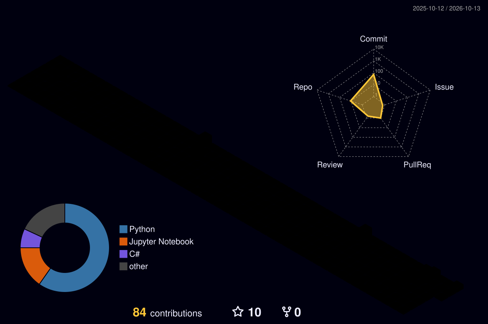

<!--
CYBERPUNK GAME-WORLD GITHUB PROFILE // MINA MAHER
-->

<p align="center">
  
</p>

<h1 align="center">MINA MAHER // AI ENGINEER</h1>

<p align="center">
  <b>Building intelligent agents, useful developer tools, and systems that turn ideas into working software.</b>
</p>

<p align="center">
  <a href="https://github.com/minamaher005?tab=repositories"></a>
  
  
</p>

<p align="center">
  <a href="https://github.com/minamaher005"></a>
  <a href="https://www.linkedin.com/in/mina-maher-ju0438/"></a>
  <a href="mailto:mina005smart@gmail.com"></a>
</p>

---

## `START_HERE` · Character profile

```text
╭──────────────────────────────────────────────────────────────╮
│  CALLSIGN   MINA MAHER                                       │
│  SPECIALTY  Agentic systems · LLM applications · Backend      │
│  CURRENTLY  Building, experimenting, and shipping             │
│  PLAYSTYLE  Curious · Systems thinker · Open-source minded    │
╰──────────────────────────────────────────────────────────────╯
```

I enjoy building software where AI meets real systems: agent workflows, tool use, retrieval, model routing, APIs, and dependable backend infrastructure. I care about more than a clever demo—I want the system to be useful, observable, and maintainable.

- **Main quests:** AI agents, LLM application architecture, orchestration, and backend engineering.
- **Side quests:** MCP tools, retrieval systems, database design, and developer experience.
- **Current mindset:** Build small, measure what matters, and improve the system one iteration at a time.

## `QUEST_LOG` · Projects

<details open>
  <summary><b>🩺 Quest 01 — Cairo Care</b></summary>
  <br />
  AI-Powered Medical Assistant & Emergency Hospital Routing for Greater Cairo. Built with FastAPI and Python, featuring triage workflows, hospital discovery, and emergency routing.
  <br /><br />
  <a href="https://github.com/minamaher005/Cairo_Care"></a>
  <br /><br />
  <sub>STATUS: Active · Built with FastAPI & Python</sub>
</details>

<details>
  <summary><b>🤖 Quest 02 — Agentic RAG System</b></summary>
  <br />
  An autonomous Retrieval-Augmented Generation (RAG) application built with LangGraph and LangChain. Intelligently selects data sources to query, grades document relevance, rewrites queries dynamically, and generates grounded answers.
  <br /><br />
  <a href="https://github.com/minamaher005/Agentic_Rag"></a>
  <br /><br />
  <sub>STATUS: Active · LangGraph & LangChain</sub>
</details>

<details>
  <summary><b>🛡️ Quest 03 — Support Copilot</b></summary>
  <br />
  An enterprise AI Support Copilot featuring LangGraph multi-agent orchestration, guardrails, human-in-the-loop approvals, conversational memory, and knowledge base ingestion.
  <br /><br />
  <a href="https://github.com/minamaher005/Customer_agent_proj"></a>
  <br /><br />
  <sub>STATUS: Active · Multi-Agent Architecture</sub>
</details>

<details>
  <summary><b>⚡ Quest 04 — Microsoft CLI Test Generator</b></summary>
  <br />
  A command-line developer tool powered by LLMs and Python AST parsing to automatically inspect Python functions and generate comprehensive unittest test suites.
  <br /><br />
  <a href="https://github.com/minamaher005/CLI_Test_Generator_proj"></a>
  <br /><br />
  <sub>STATUS: Active · Python AST & LLM Tooling</sub>
</details>

## `INVENTORY` · Tech stack

<p align="center">
  
</p>

<p align="center">
  
  
  
</p>

## `WORLD_MAP` · Your coding world

This animated 3D contribution world is generated automatically by GitHub Actions. The first image appears after the **GitHub Profile 3D Contrib** workflow succeeds.

<p align="center">
  
</p>

<details>
  <summary>Alternative worlds (optional)</summary>
  <br />
  Once the workflow has generated these files, you can swap the image above for one of these styles:
  <br /><br />
  <code>./profile-3d-contrib/profile-green-animate.svg</code> — animated green
  <br />
  <code>./profile-3d-contrib/profile-season-animate.svg</code> — seasonal colors
  <br />
  <code>./profile-3d-contrib/profile-night-view.svg</code> — night view
  <br />
  <code>./profile-3d-contrib/profile-gitblock.svg</code> — block-style view
</details>

## `ARCADE` · Play the contribution map

The arcade animation turns your contribution calendar into a game. It is generated on a separate `output` branch by GitHub Actions. If the image is missing on your first visit, follow `SETUP.md` and run the workflow manually once.

<p align="center">
  <picture>
    <source media="(prefers-color-scheme: dark)" srcset="https://raw.githubusercontent.com/minamaher005/minamaher005/output/pacman-contribution-graph-dark.svg" />
    <source media="(prefers-color-scheme: light)" srcset="https://raw.githubusercontent.com/minamaher005/minamaher005/output/pacman-contribution-graph.svg" />
    
  </picture>
</p>

<p align="center"><sub>Arcade visual generated by <a href="https://github.com/abozanona/pacman-contribution-graph">pacman-contribution-graph</a>.</sub></p>

## `COMMS` · Find me online

<p align="center">
  <a href="https://github.com/minamaher005">GitHub</a>
  &nbsp;·&nbsp;
  <a href="https://www.linkedin.com/in/mina-maher-ju0438/">LinkedIn</a>
  &nbsp;·&nbsp;
  <a href="mailto:mina005smart@gmail.com">Email</a>
</p>

---

<p align="center">
  <sub>Thanks for visiting my world. Pick a quest, explore the code, and feel free to open an issue or start a conversation.</sub>
</p>
